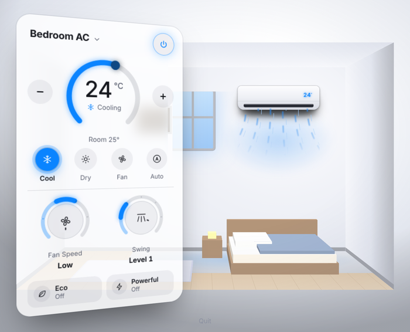
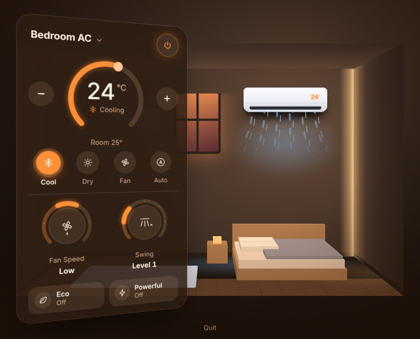
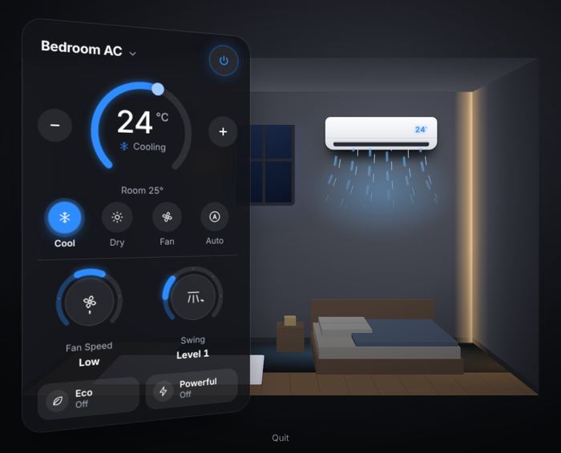
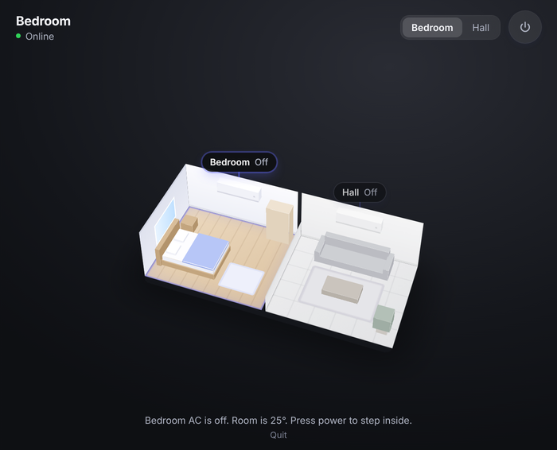

# AC Widget

A macOS menubar panel for controlling smart air conditioners.

Click the menubar item and the panel opens into a small 3D model of the room,
with the air conditioner on the wall and the controls floating beside it. The
theme follows the time of day, and fan speed and swing are rotary knobs you can
turn with the mouse or a remote.

Air conditioners are reached through a driver layer, so support for a new
manufacturer is one file and one line of registration — the interface adapts on
its own to whatever that unit can do.

| Morning | Evening | Night |
|---|---|---|
|  |  |  |

With the air conditioner off, the panel shows the whole home instead, and you
pick a room to step into:



---

## Contents

- [Overview](#overview)
- [Features](#features)
- [Requirements](#requirements)
- [Installation](#installation)
- [Configuration](#configuration)
- [Usage](#usage)
- [Supported brands](#supported-brands)
- [Adding a brand](#adding-a-brand)
- [Project layout](#project-layout)
- [Known limitations](#known-limitations)
- [Security considerations](#security-considerations)
- [Legal and disclaimers](#legal-and-disclaimers)
- [License](#license)

---

## Overview

Most air conditioners ship with a phone app and a remote. This project puts the
same controls one click away in the macOS menubar, and presents them as a room
you look into rather than a list of settings.

The panel is a small local web page rendered in a native menubar popover. A
Python process holds the connection to the air conditioner and serves that page
over a loopback socket. The 3D room is CSS transforms — there is no WebGL, no
bundler and no front-end framework.

## Features

**The room**
- Air conditioner off: the whole home from above, one tile per room.
- Air conditioner on: the view zooms into that room, seen from inside, with the
  unit on the wall showing its set temperature and animated airflow.
- Multiple units are supported, one per room, switched from a menu or by
  tapping a room in the overview.

**Time-of-day themes**
- Morning (06:00–16:59): bright, clean white.
- Evening (17:00–19:59): warm amber and orange.
- Night (20:00–05:59): deep black with soft lighting.
- The theme changes on its own and cross-fades over about a second. Room
  surfaces, furniture, window, glass panel and accent colour all move together.

**Controls**
- Temperature dial with drag, `−`/`+` buttons and arrow keys.
- Mode buttons, rotary fan-speed and swing knobs, and preset toggles.
- Only the controls the selected unit reports are drawn; the window resizes to
  fit what is left.

**Remote navigation**
- Arrow keys move between controls, `Enter` picks a knob up, arrows then turn
  it, `Enter` or `Esc` puts it down. `Esc` on the panel turns the unit off.

**Optional network access**
- A token-guarded endpoint on the local network, for driving the same controls
  from a TV or phone. Off unless configured.

## Requirements

- macOS 11 (Big Sur) or newer
- Python 3.9 or newer
- An air conditioner supported by one of the [drivers](#supported-brands)

## Installation

```bash
git clone https://github.com/Bharathshiva24/AC-Widget.git ~/ac-control
cd ~/ac-control

python3 -m venv venv
source venv/bin/activate
pip install -r requirements.txt

bash setup.sh
```

`setup.sh` asks which brand you have, asks for that brand's credentials, stores
them in the **macOS Keychain**, records the brand in `config.json`, and installs
`AC.app` into `/Applications`. Look for **AC** in your menubar.

To re-install or update after pulling changes, without re-entering credentials:

```bash
bash install.sh
```

To launch the app automatically at login: System Settings → General → Login
Items → **+** → AC.

## Configuration

### Credentials

Credentials live in the macOS Keychain under the service `ac-panel`, with the
account name `<brand-id>.<field>` — for example `miraie.mobile`. `setup.sh`
writes them; the app reads them into memory at startup. They are never written
to disk by this project.

### Environment variables

Everything can also be supplied through the environment, which is useful for
development or for machines without a Keychain. Copy `.env.example` to `.env`
and fill in what you need:

```bash
cp .env.example .env
```

`.env` is ignored by Git. Precedence is: variables already set in the shell,
then `.env`, then the Keychain.

| Variable | Purpose |
|---|---|
| `AC_BRAND` | Override the brand recorded in `config.json` |
| `AC_<BRAND>_<FIELD>` | A brand credential, e.g. `AC_MIRAIE_MOBILE` |
| `AC_LAN_PORT`, `AC_LAN_TOKEN` | Enable network access (both required) |
| `AC_SWAP_ROOMS` | Swap which unit is the bedroom and which the hall |
| `AC_DEMO_CAPS` | Demo brand: `minimal` for a reduced-capability unit |

### Files

| File | Purpose | Tracked |
|---|---|---|
| `config.json` | Which brand this machine uses | No — local state |
| `.env` | Local secrets and overrides | No — ignored |
| `lan_token` | Generated token for network access | No — ignored |
| `ac_panel.log` | Runtime log | No — ignored |

## Usage

| Action | How |
|---|---|
| Open the panel | Click **AC** in the menubar |
| Turn on or off | The power button, or `Esc` to switch off |
| Set temperature | Drag the dial, use `−` / `+`, or arrow keys |
| Change mode | Click a mode button |
| Fan speed / swing | Click a segment or drag around the knob |
| Switch room | The name dropdown, or tap a room in the overview |
| Quit | **Quit** at the bottom of the panel |

Run without any hardware:

```bash
python ac_panel.py --demo
```

Preview a theme without waiting for the clock — append `?tod=morning`,
`?tod=evening` or `?tod=night` to the panel's address in a browser.

## Supported brands

| Brand | Connectivity | Status |
|---|---|---|
| Panasonic MirAIe | Cloud (MQTT) | Tested against production units |
| Demo | Simulated | Built in; no hardware or account needed |

Panasonic MirAIe support uses the community
[`miraie-ac-in`](https://pypi.org/project/miraie-ac-in/) library. It does not
work with Panasonic units that use the global Comfort Cloud app.

## Adding a brand

Each brand is one file under `acbrands/` that declares what the unit can do and
implements two methods. The panel reads that declaration and draws only those
controls, so a unit without swing simply never gets that knob — no interface
code changes.

1. Copy `acbrands/template.py` to `acbrands/yourbrand.py`.
2. Fill in `CAPS` (modes, fan speeds, swing levels, presets, temperature range)
   and implement `connect()`, `command()` and `Device.snapshot()`.
3. Add one line to the `BRANDS` table in `acbrands/__init__.py`.

`setup.sh` then offers the brand and collects the credential fields it
declares. `acbrands/template.py` carries notes for the three common cases:
cloud accounts, local-network devices and infrared blasters.

## Project layout

```
ac_panel.py            the app: state, local server, menubar, and the UI
acbrands/
  base.py              Capabilities / Device / ACDriver contract
  __init__.py          brand registry, config and credential loading
  miraie.py            Panasonic MirAIe driver
  demo.py              simulator
  template.py          starting point for a new brand
AC.app/                macOS bundle: launcher, Info.plist, icon
setup.sh               pick a brand, save credentials, install
install.sh             re-install the app without touching credentials
```

## Known limitations

- **macOS only.** The menubar popover uses PyObjC and WebKit. The driver layer
  and the panel itself are portable, but the shell around them is not.
- **Unofficial integrations.** Cloud drivers talk to manufacturer services that
  have no published API. A vendor change can break them without notice.
- **Two rooms.** The 3D view models a bedroom and a hall. More units than that
  are read but not drawn.
- **Generic rooms.** The furniture is illustrative, not your actual floor plan.
- **MirAIe capability set.** Heat mode, the self-clean preset and the display
  toggle exist in the underlying library but are left out, because the units
  this was tested against ignore them. They are one line each to enable in
  `acbrands/miraie.py`.
- **No scheduling or automation.** This is a controller, not a thermostat.

## Security considerations

- **No secrets in this repository.** Credentials are read from the Keychain or
  the environment at runtime. `.gitignore` covers `.env`, tokens, logs and
  local state.
- **Local server.** The panel binds to a random loopback port and requires a
  per-run token on every request; the `Host` header is checked as well.
- **Network access is opt-in.** The LAN endpoint only starts when both
  `AC_LAN_PORT` and `AC_LAN_TOKEN` are set. It is plain HTTP guarded by a shared
  token, which is reasonable on a home network and not suitable for exposure to
  the internet. Do not port-forward it.
- **Logs.** `ac_panel.log` records connection failures and, on an authentication
  error, a masked login identifier and the password *length* — never the
  password. It is ignored by Git.
- **Dependencies.** A short, pinned list in `requirements.txt`; brand libraries
  are imported only when that brand is selected.
- If you suspect a credential has been exposed, change it in the manufacturer's
  app and re-run `bash setup.sh`.

## Legal and disclaimers

This is an independent, unofficial project. It is **not affiliated with,
endorsed by, or supported by Panasonic Corporation** or any other
manufacturer. "Panasonic" and "MirAIe" are trademarks of their respective
owners and are used here only to describe compatibility.

Communication with manufacturer services relies on community-maintained
libraries and undocumented endpoints. Using them may be inconsistent with the
terms of service of the manufacturer's app — review those terms and decide for
yourself. You are responsible for the equipment you control with this software.

The software is provided "as is", without warranty of any kind, as set out in
the [LICENSE](LICENSE). Controlling heating and cooling equipment carries real
consequences: no part of this project should be relied on for safety, for
temperature-critical environments, or in any setting where a failure to start,
stop or regulate would cause harm.

## License

[MIT](LICENSE).
