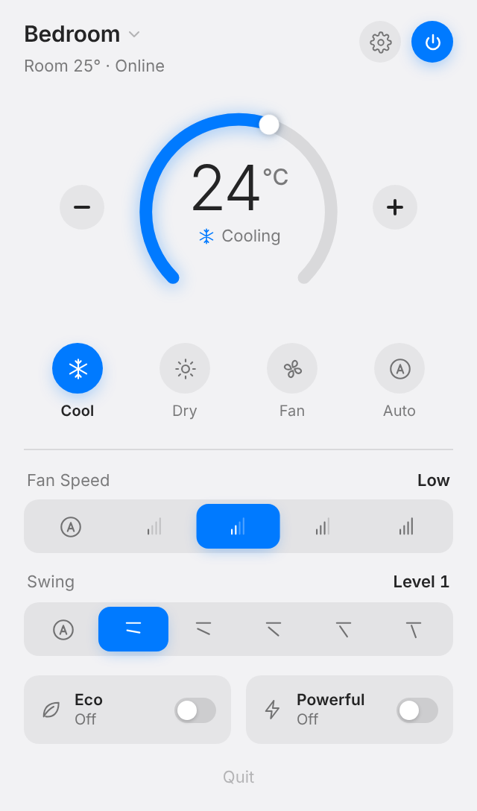
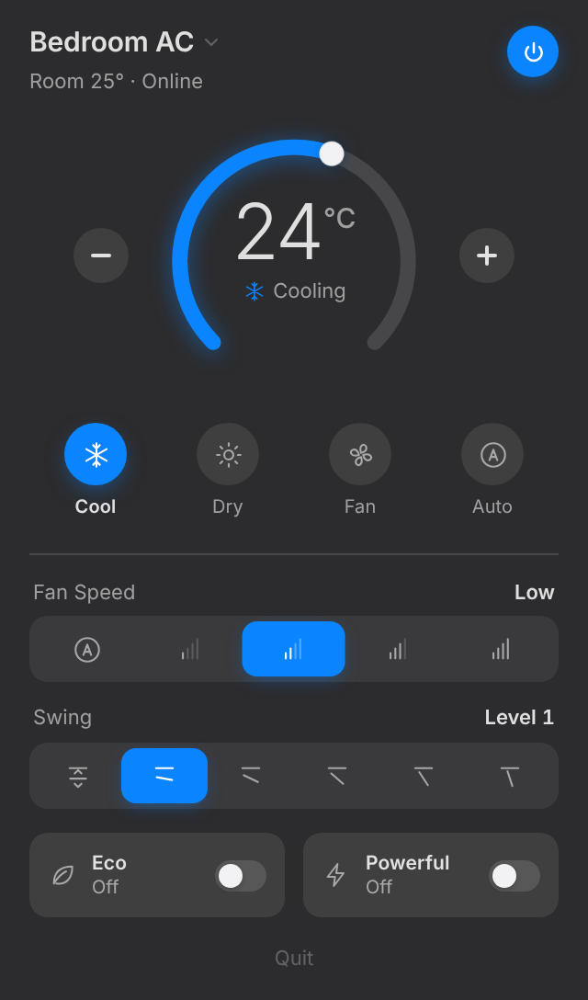
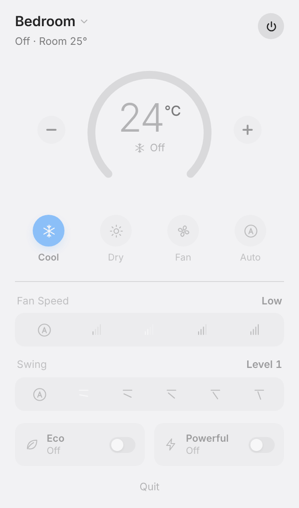

# AC Widget

A macOS menubar panel for controlling smart air conditioners.

Click the menubar item and a compact panel drops down with everything on one
screen: a temperature dial, the running mode, fan speed, swing and presets. It
follows the system light or dark setting and is built to feel like a part of
macOS rather than a web page in a window.

Air conditioners are reached through a driver layer, so support for a new
manufacturer is one file and one line of registration — the interface adapts on
its own to whatever that unit can do.

| Light | Dark | Switched off |
|---|---|---|
|  |  |  |

---

## Contents

- [Overview](#overview)
- [Features](#features)
- [Requirements](#requirements)
- [Installation](#installation)
- [Configuration](#configuration)
- [Usage](#usage)
- [Supported brands](#supported-brands)
- [Adding a brand](#adding-a-brand)
- [Project layout](#project-layout)
- [Known limitations](#known-limitations)
- [Security considerations](#security-considerations)
- [Legal and disclaimers](#legal-and-disclaimers)
- [License](#license)

---

## Overview

Most air conditioners ship with a phone app and a remote. This project puts the
same controls one click away in the macOS menubar, in a panel that reads as a
native one rather than a list of settings.

The panel is a small local web page rendered in a native menubar popover. A
Python process holds the connection to the air conditioner and serves that page
over a loopback socket. Everything on screen is plain CSS and inline SVG —
there is no bundler and no front-end framework.

## Features

**The panel**
- A 320pt popover that sizes itself to its contents: a 270° temperature dial,
  mode buttons, fan speed and swing selectors, and preset toggles.
- Switched off, the dial goes quiet and the controls dim in place rather than
  disappearing, so the panel never jumps around.
- Multiple units are supported, switched from the name dropdown in the header.

**Automatic control**
- Optional: the air conditioner runs while the MacBook lid is open **or** a
  projector is on, and switches off only once both are off.
- Off by default, turned on from the settings panel behind the gear icon, which
  also shows both inputs live so you can see what it is reacting to.
- Acts on the unit currently shown in the panel, so changing units moves the
  automation with it.
- Reacts to changes rather than reconciling continuously, so switching a unit
  off by hand stays off until the lid or the projector actually moves.
- The lid is read two ways, because neither alone is enough: the system sleep
  and wake notifications, and the clamshell flag macOS uses itself. The second
  catches a lid closed in clamshell mode, where the Mac stays awake on an
  external display and never posts a sleep notification.
- When the projector's state cannot be read, nothing is switched off. Leaving a
  unit running is the cheaper mistake.

**Appearance**
- Follows the macOS light or dark setting, using the system accent blue.
- Colours, spacing and radii are tokens declared once at the top of the page,
  so restyling is a handful of values rather than a sweep through the CSS.

**Controls**
- Temperature dial with drag, `−`/`+` buttons and arrow keys.
- Mode buttons, segmented fan-speed and swing selectors, and preset toggles.
- Only the controls the selected unit reports are drawn; the window resizes to
  fit what is left.

**Remote navigation**
- Arrow keys move between controls and `Enter` activates the focused one.
  `Esc` closes the device menu, or switches the unit off.

**Optional network access**
- A token-guarded endpoint on the local network, for driving the same controls
  from a TV or phone. Off unless configured.

## Requirements

- macOS 11 (Big Sur) or newer
- Python 3.9 or newer
- An air conditioner supported by one of the [drivers](#supported-brands)

## Installation

```bash
git clone https://github.com/Bharathshiva24/AC-Widget.git ~/ac-control
cd ~/ac-control

python3 -m venv venv
source venv/bin/activate
pip install -r requirements.txt

bash setup.sh
```

`setup.sh` asks which brand you have, asks for that brand's credentials, stores
them in the **macOS Keychain**, records the brand in `config.json`, and installs
`AC.app` into `/Applications`. Look for **AC** in your menubar.

To re-install or update after pulling changes, without re-entering credentials:

```bash
bash install.sh
```

To launch the app automatically at login: System Settings → General → Login
Items → **+** → AC.

## Configuration

### Credentials

Credentials live in the macOS Keychain under the service `ac-panel`, with the
account name `<brand-id>.<field>` — for example `miraie.mobile`. `setup.sh`
writes them; the app reads them into memory at startup. They are never written
to disk by this project.

### Environment variables

Everything can also be supplied through the environment, which is useful for
development or for machines without a Keychain. Copy `.env.example` to `.env`
and fill in what you need:

```bash
cp .env.example .env
```

`.env` is ignored by Git. Precedence is: variables already set in the shell,
then `.env`, then the Keychain.

| Variable | Purpose |
|---|---|
| `AC_BRAND` | Override the brand recorded in `config.json` |
| `AC_<BRAND>_<FIELD>` | A brand credential, e.g. `AC_MIRAIE_MOBILE` |
| `AC_LAN_PORT`, `AC_LAN_TOKEN` | Enable network access (both required) |
| `AC_SWAP_ROOMS` | Swap which unit is the bedroom and which the hall |
| `AC_DEMO_CAPS` | Demo brand: `minimal` for a reduced-capability unit |
| `AC_PROJECTOR_HOST`, `AC_PROJECTOR_METHOD` | Projector address, and how to read it |

### Projector (optional)

Automation can include a projector, so a film keeps the air conditioner running
with the lid shut. Add its address to `config.json`:

```json
{
  "brand": "miraie",
  "lid_control": true,
  "projector": { "host": "192.168.1.50", "method": "ping" }
}
```

Find the address in your router's client list, or on the projector under
network settings.

| Method | How it reads the projector | Setup |
|---|---|---|
| `ping` | Presence on the network counts as running | None |
| `adb` | Asks Google TV whether its display is awake | Network debugging, plus `adb` on your Mac |

The Epson EpiqVision Mini range, the EF-21W included, has no LAN port and
supports neither PJLink nor ESC/VP.net, so there is no projector protocol to
ask. Both methods read the Google TV side instead.

`ping` is only truthful if your projector actually leaves the network when it
is off. Many Google TV devices stay connected in standby to listen for casts,
in which case ping always reports *on* and the unit never switches off. Check
it: with the projector off, the Projector chip in Settings should read `off`
within about ten seconds. If it stays on, use `adb` instead:

```bash
brew install --cask android-platform-tools
adb connect 192.168.1.50:5555     # then accept the prompt on the projector
```

Then set `"method": "adb"`. This reads Android's own wakefulness, so standby
reads as off even while the projector stays on the network.

### Files

| File | Purpose | Tracked |
|---|---|---|
| `config.json` | Which brand this machine uses, and your settings | No — local state |
| `.env` | Local secrets and overrides | No — ignored |
| `lan_token` | Generated token for network access | No — ignored |
| `ac_panel.log` | Runtime log | No — ignored |

## Usage

| Action | How |
|---|---|
| Open the panel | Click **AC** in the menubar |
| Turn on or off | The power button, or `Esc` to switch off |
| Set temperature | Drag the dial, use `−` / `+`, or arrow keys |
| Change mode | Click a mode button |
| Fan speed / swing | Click an option in the selector |
| Switch unit | The name dropdown in the header |
| Settings | The gear icon, left of the power button |
| Automation | Settings → **Automatic control** |
| Quit | **Quit** at the bottom of the panel |

Run without any hardware:

```bash
python ac_panel.py --demo
```

## Supported brands

| Brand | Connectivity | Status |
|---|---|---|
| Panasonic MirAIe | Cloud (MQTT) | Tested against production units |
| Demo | Simulated | Built in; no hardware or account needed |

Panasonic MirAIe support uses the community
[`miraie-ac-in`](https://pypi.org/project/miraie-ac-in/) library. It does not
work with Panasonic units that use the global Comfort Cloud app.

## Adding a brand

Each brand is one file under `acbrands/` that declares what the unit can do and
implements two methods. The panel reads that declaration and draws only those
controls, so a unit without swing simply never gets that selector — no
interface code changes.

1. Copy `acbrands/template.py` to `acbrands/yourbrand.py`.
2. Fill in `CAPS` (modes, fan speeds, swing levels, presets, temperature range)
   and implement `connect()`, `command()` and `Device.snapshot()`.
3. Add one line to the `BRANDS` table in `acbrands/__init__.py`.

`setup.sh` then offers the brand and collects the credential fields it
declares. `acbrands/template.py` carries notes for the three common cases:
cloud accounts, local-network devices and infrared blasters.

## Project layout

```
ac_panel.py            the app: state, local server, menubar, and the UI
acbrands/
  base.py              Capabilities / Device / ACDriver contract
  __init__.py          brand registry, config and credential loading
  miraie.py            Panasonic MirAIe driver
  demo.py              simulator
  template.py          starting point for a new brand
AC.app/                macOS bundle: launcher, Info.plist, icon
setup.sh               pick a brand, save credentials, install
install.sh             re-install the app without touching credentials
```

## Known limitations

- **macOS only.** The menubar popover uses PyObjC and WebKit. The driver layer
  and the panel itself are portable, but the shell around them is not.
- **Unofficial integrations.** Cloud drivers talk to manufacturer services that
  have no published API. A vendor change can break them without notice.
- **Two rooms.** Units are mapped to a bedroom and a living room. More than
  two are read and controllable, but only the first two are named.
- **MirAIe capability set.** Heat mode, the self-clean preset and the display
  toggle exist in the underlying library but are left out, because the units
  this was tested against ignore them. They are one line each to enable in
  `acbrands/miraie.py`.
- **Automation needs the app running.** It is the panel that reacts to the lid
  and the projector, so nothing is sent if it is not running when they move.
  Closing the lid on battery sleeps the Mac within moments: the off command
  goes out from the sleep notification, which normally wins that race but
  cannot be guaranteed on a slow or dropped connection.
- **Projector state is inferred, not reported.** The EpiqVision Mini exposes no
  control protocol, so both methods read the Google TV side. See
  [Projector](#projector-optional) for which one to trust.
- **No scheduling.** Beyond the lid, this is a controller, not a thermostat.

## Security considerations

- **No secrets in this repository.** Credentials are read from the Keychain or
  the environment at runtime. `.gitignore` covers `.env`, tokens, logs and
  local state.
- **Local server.** The panel binds to a random loopback port and requires a
  per-run token on every request; the `Host` header is checked as well.
- **Network access is opt-in.** The LAN endpoint only starts when both
  `AC_LAN_PORT` and `AC_LAN_TOKEN` are set. It is plain HTTP guarded by a shared
  token, which is reasonable on a home network and not suitable for exposure to
  the internet. Do not port-forward it.
- **Logs.** `ac_panel.log` records connection failures and, on an authentication
  error, a masked login identifier and the password *length* — never the
  password. It is ignored by Git.
- **Dependencies.** A short, pinned list in `requirements.txt`; brand libraries
  are imported only when that brand is selected.
- If you suspect a credential has been exposed, change it in the manufacturer's
  app and re-run `bash setup.sh`.

## Legal and disclaimers

This is an independent, unofficial project. It is **not affiliated with,
endorsed by, or supported by Panasonic Corporation** or any other
manufacturer. "Panasonic" and "MirAIe" are trademarks of their respective
owners and are used here only to describe compatibility.

Communication with manufacturer services relies on community-maintained
libraries and undocumented endpoints. Using them may be inconsistent with the
terms of service of the manufacturer's app — review those terms and decide for
yourself. You are responsible for the equipment you control with this software.

The software is provided "as is", without warranty of any kind, as set out in
the [LICENSE](LICENSE). Controlling heating and cooling equipment carries real
consequences: no part of this project should be relied on for safety, for
temperature-critical environments, or in any setting where a failure to start,
stop or regulate would cause harm.

## License

[MIT](LICENSE).
